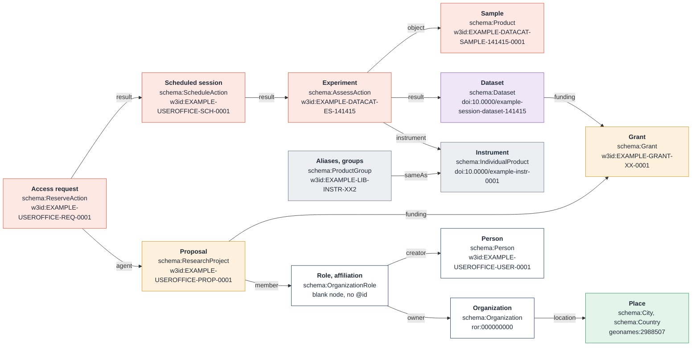
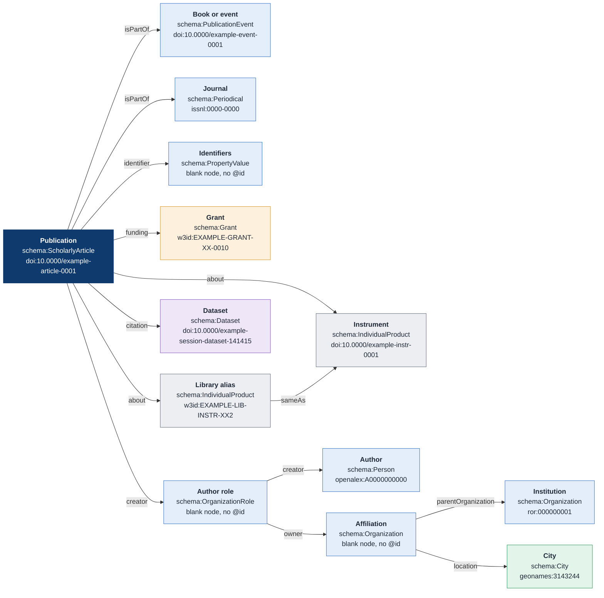

# OpenFacility

**A knowledge graph model for research facilities.** OpenFacility is a schema.org application profile for any research facility: its instruments, projects, sessions and schedules, samples, datasets and publications, the people and organizations around them, and the sources they come from. It comes with SHACL validation rules, a store layout and the tools to build and check the data.

It names no scientific domain and no facility. It is built in layers:

- **core**: the generic model, shapes, mapping patterns and tools;
- **profiles**: the wording and agreed values of a community, or of a concern several communities share (e.g. scholarly publishing);
- **facility applications**: one facility's IRIs, source systems and data. Several facilities can share one store.

```
                 +-- profile (e.g. a community) <- profile -+
OpenFacility core  <-----+                                          +--  facility application
   ^             +-- profile (e.g. scholarly) --------------+          |
   |                                                                   |
   +------------------------ shared data ------------------------------+   (places, organizations)
```

Dependencies go one way only: a facility uses its profiles and the core, a profile uses its parents and the core, the core uses nothing. Every source is a `schema:DataCatalog`, and everything a source says about a thing is in that thing's record in the catalogue.

IRIs live under `https://w3id.org/fifi/`. Everything is [CC0 1.0](https://creativecommons.org/publicdomain/zero/1.0/).

## The model in two graphs

Each box is one node: its role, its schema.org type and an example IRI. The ids are placeholders from the [core examples](https://github.com/openfacility/openfacility-core/tree/HEAD/mapping/examples).

### A facility: from request to data



Colours: red, sessions and samples · orange, proposals and grants · grey, instruments · purple, datasets · white, people and organizations · green, places.

### A publication and what it links to

This graph adds the [scholarly profile](https://github.com/openfacility/openfacility-profile-scholarly) to the core.



Colours: blue, the publication and its metadata · orange, grants · grey, instruments · purple, datasets · green, places.

## Repositories

| Repository | What |
|---|---|
| [openfacility-core](https://github.com/openfacility/openfacility-core) | the model: query profile, SHACL shapes, mapping docs with validated examples, build and validation tools. **Start here.** |
| [openfacility-core-alignment](https://github.com/openfacility/openfacility-core-alignment) | the alignment of the model with W3C PROV-O and SOSA/SSN, and its checks |
| [openfacility-core-data-places](https://github.com/openfacility/openfacility-core-data-places) | shared source `places`: cities, administrative areas and countries (GeoNames, Wikidata) |
| [openfacility-core-data-organizations](https://github.com/openfacility/openfacility-core-data-organizations) | shared source `organizations`: ROR records |
| [openfacility-profile-scholarly](https://github.com/openfacility/openfacility-profile-scholarly) | profile for scholarly publishing: articles, journals, conferences, publishers, citation and journal metrics |

## Getting started

The projects are checked out side by side in one workspace folder and find each other there.

```bash
git clone https://github.com/openfacility/openfacility-core
git clone https://github.com/openfacility/openfacility-core-data-places
git clone https://github.com/openfacility/openfacility-core-data-organizations
pip install -r openfacility-core/scripts/requirements.txt
```

Then read [openfacility-core/README.md](https://github.com/openfacility/openfacility-core#readme) and the [mapping docs](https://github.com/openfacility/openfacility-core/tree/HEAD/mapping).
